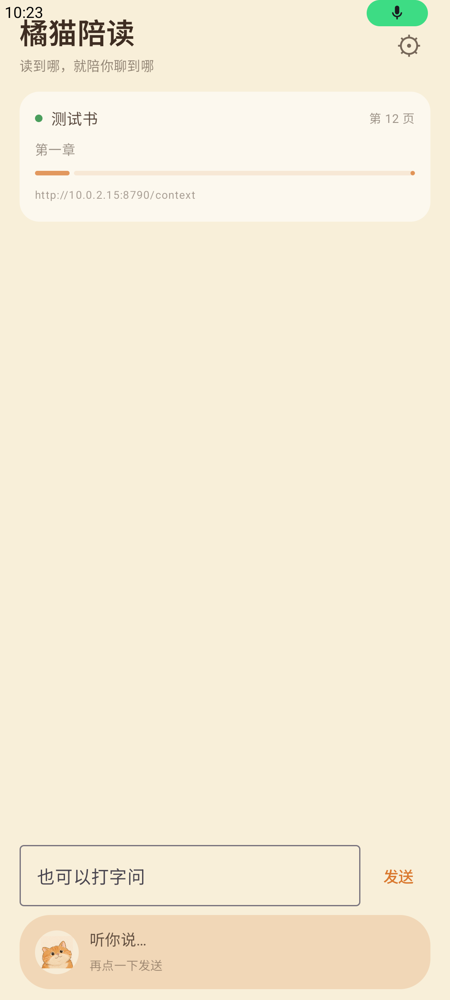

# 橘猫陪读 Android

**English** | [简体中文](README.zh-CN.md)

An Android reading companion for Kindle + KOReader. It receives the current page over a local HTTP bridge, supports Tencent Cloud one-sentence Chinese ASR, streams answers from OpenCode Go, and reads them with Edge TTS (falling back to Android system TTS).

> This is the Android MVP. The iOS app and Kindle plugin are separate repositories:
> [reading-companion-ios](https://github.com/successcw/reading-companion-ios) ·
> [koreader-ai-reading](https://github.com/successcw/koreader-ai-reading)



## Features

- Local HTTP server on port `8790` (`/health`, `/context`), compatible with the KOReader `ai_bridge` plugin.
- Kindle context card: book, chapter, page, progress.
- Push-to-talk recording with Android `AudioRecord`; Tencent Cloud one-sentence ASR.
- OpenCode Go streaming chat.
- Edge neural TTS with automatic Android system TTS fallback; cat idle/listening/talking states.
- Foreground service keeps the local Kindle bridge alive when the app is in the background.
- UDP LAN discovery (`8791`): Kindle can find the app after switching between hotspot and home Wi-Fi.
- Text input fallback for testing or typing a question.
- Keys stored with AndroidX EncryptedSharedPreferences.

## What you need to apply for

| Credential | Required? | Where |
|---|---|---|
| **OpenCode Go API key** | Yes, for AI replies | https://opencode.ai/ |
| **Tencent Cloud SecretId + SecretKey** | Yes for voice input | Enable **一句话识别** at https://console.cloud.tencent.com/asr; create keys at https://console.cloud.tencent.com/cam/capi |
| Android SDK / emulator | Build/test only | Android Studio or command-line SDK |

- Tencent Cloud one-sentence ASR has **5,000 free calls/month**; pricing: https://cloud.tencent.com/document/product/1093/35686/
- Use the ASR `SecretId` / `SecretKey`, not a TRTC `SDKAppID`.
- `Token` in the app is only the local shared secret with the Kindle plugin; default `change-me`.

## Prebuilt APK

Debug build, installable with `adb install` or a file manager.

[Download the debug APK](dist/reading-companion-android-0.2.2-debug.apk)

SHA-256:

```text
ce1b4e3e56e5cfb1b9cd75a6a876888f03591a4c0f5796b88e2a6ddfe81bf3d5
```

## Build and run

Requires JDK 17 and Android SDK 35.

```bash
cd reading-companion-android
./gradlew :app:assembleDebug
adb install -r app/build/outputs/apk/debug/app-debug.apk
adb shell am start -n com.cg.readingcompanion.android/.MainActivity
```

On a physical Android phone:

1. Open Personal Hotspot and keep the app in the foreground.
2. The plugin broadcasts `READING_COMPANION_DISCOVER_V1` on UDP `8791` and receives the app's current URL automatically.
3. If discovery is blocked by the router, use the address shown in the app and put it in the Kindle plugin's `config.lua`.

## Emulator verification

Verified with an Android emulator (API 36):

```bash
adb forward tcp:8790 tcp:8790
curl -H 'X-Companion-Token: change-me' http://127.0.0.1:8790/health
# {"ok":true}

curl -X POST http://127.0.0.1:8790/context \
  -H 'Content-Type: application/json; charset=utf-8' \
  -H 'X-Companion-Token: change-me' \
  --data '{"book":"测试书","chapter":"第一章","page":12,"progress":8.5,"text":"测试内容","updatedAt":0}'
# {"ok":true}
```

The emulator UI updates the context card and shows the recording state. Microphone/Tencent/OpenCode/TTS need real credentials and a working microphone to verify end-to-end.

## Privacy

- Kindle page text is sent to OpenCode Go for inference.
- Recorded audio is sent to Tencent Cloud when ASR is configured.
- Keys are stored in encrypted preferences; no key is committed to this repository.
- The app currently keeps the HTTP server in the Activity; keep it in the foreground. A foreground service is planned.

## Limitations

- ASR/LLM/TTS end-to-end needs your own keys and a real microphone. Edge TTS is an unofficial endpoint and may change.
- This is not an App Store/Play Store-ready release.

## License

MIT for the Android code. See `THIRD_PARTY.md` for dependencies.
