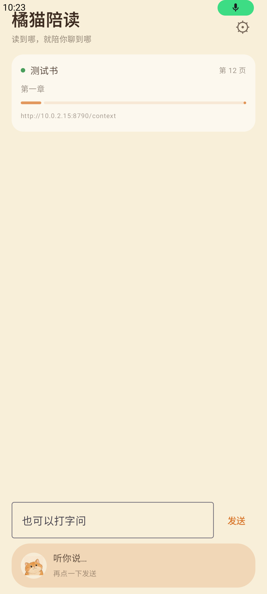

# 橘猫陪读 Android

[English](README.md) | **简体中文**

Android 版 Kindle + KOReader AI 陪读：本地 HTTP 接收当前页，腾讯云一句话识别，OpenCode Go 流式回答，Android 系统 TTS 朗读。

> 这是 Android MVP。iOS App 和 Kindle 插件是独立仓库：
> [reading-companion-ios](https://github.com/successcw/reading-companion-ios) ·
> [koreader-ai-reading](https://github.com/successcw/koreader-ai-reading)



## 功能

- 本地 HTTP 服务：`8790` 端口的 `/health`、`/context`，兼容 KOReader `ai_bridge` 插件；
- Kindle 上下文卡片：书名、章节、页码、进度；
- 点按录音，`AudioRecord` 采集，腾讯云一句话识别；
- OpenCode Go 流式回答；
- Android 系统 TTS；猫咪空闲/听/说状态；
- 文字输入兜底，方便测试或直接打字；
- 密钥用 AndroidX EncryptedSharedPreferences 存储。

## 需要申请哪些 Key

| 凭证 | 是否必需 | 位置 |
|---|---|---|
| **OpenCode Go API Key** | 必需，用于 AI 回答 | https://opencode.ai/ |
| **腾讯云 SecretId + SecretKey** | 语音输入需要 | 在 https://console.cloud.tencent.com/asr 开通「一句话识别」，到 https://console.cloud.tencent.com/cam/capi 创建密钥 |
| Android SDK / 模拟器 | 仅构建测试 | Android Studio 或命令行 SDK |

- 腾讯云一句话识别每月 **5,000 次免费**；计费见 https://cloud.tencent.com/document/product/1093/35686/
- 用语音识别的 `SecretId` / `SecretKey`，不是 TRTC 的 `SDKAppID`；
- App 里的 `Token` 只是和 Kindle 插件的本地共享密钥，默认 `change-me`。

## 预编译 APK

Debug 构建，可用 `adb install` 或文件管理器安装。

[Download the debug APK](dist/reading-companion-android-0.1.0-debug.apk)

SHA-256:

```text
069921a06f7e1779e88856f97c2be7b54d5a2ad98b42f588afa19ad2930f52c4
```

## 构建运行

需要 JDK 17 和 Android SDK 35。

```bash
cd reading-companion-android
./gradlew :app:assembleDebug
adb install -r app/build/outputs/apk/debug/app-debug.apk
adb shell am start -n com.cg.readingcompanion.android/.MainActivity
```

真机使用时：

1. Android 打开个人热点，App 保持前台；
2. 使用 App 首页显示的地址（Android 热点常见 `192.168.43.1`，不是 iPhone 的 `172.20.10.1`）；
3. 把地址和相同 Token 填进 Kindle 插件 `config.lua`。

## 模拟器已验证

已在 API 36 模拟器验证：

```bash
adb forward tcp:8790 tcp:8790
curl -H 'X-Companion-Token: change-me' http://127.0.0.1:8790/health
# {"ok":true}
```

POST `/context` 后，App 的书名/章节/页码会更新；录音态 UI 正常。
腾讯云/OpenCode/TTS 的完整链路需要真实密钥和可用麦克风才能验证。

## 隐私

- Kindle 当前页正文会发给 OpenCode Go；
- 配置腾讯云后，录音会发给腾讯云转写；
- 密钥只存本机加密偏好，仓库不包含 Key；
- 当前 HTTP 服务依附 Activity，App 进后台可能被挂起；后续可加前台服务。

## 已知限制

- Android MVP 使用系统 TTS，尚未移植 Edge TTS；
- 还没有前台 Service；
- ASR/LLM/TTS 端到端需要自己的 Key 和真实麦克风；
- 不是 Play Store 可直接上架的成品。

## 许可证

Android 代码 MIT；依赖许可证见 `THIRD_PARTY.md`。
